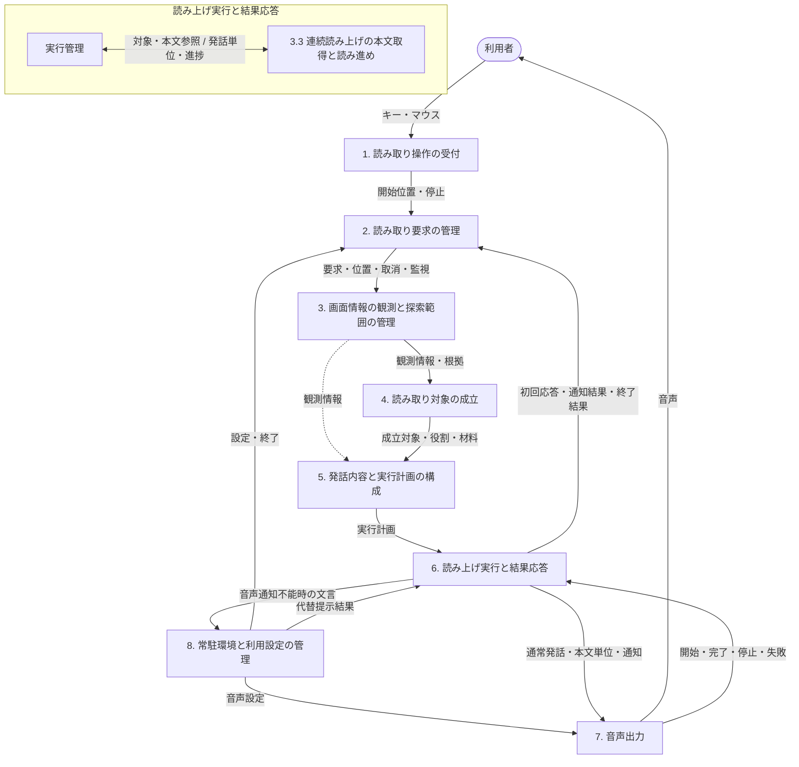

# 小説版 VoiceClick v3.0 基本設計書（v0.1）

**文書名**: 小説版ボイスクリックv3.0 基本設計書\
**文書版**: 0.1\
**作成日**: 2026-10-08\
**最終更新日**: 2026-10-08\
**文書状態**: レビュー版（基本設計正本完全準拠）\
**対象製品**: VoiceClick\
**対象製品バージョン**: v3.0（開発版）\
**原作・仕様正本**: [VoiceClick v3.0 基本設計書 v1.0](VoiceClick_v3.0_基本設計書_v1.0.md)\
**作成方針**: 赤川次郎風ユーモア・ミステリー仕立ての軽快な文体でありながら、技術基本設計書として記載事項を一切漏らさず、本書のみで詳細設計および実装に着手可能な完全仕様を担保する。

---

## はじめに：登場人物の紹介

- **夕顔 アスカ（ゆうがお・あすか）**：
  新進気鋭の女性エンジニア。大学で情報メディアとアクセシビリティを専攻し、VoiceClick開発チームに配属された。「使えないアクセシビリティなんて、ただの自己満足よ！」が信条。直感力と鋭い洞察力を持つが、時々突っ走り気味。
- **神代 シンゴ（かみしろ・しんご）**：
  几帳面で論理的な先輩システムアーキテクト。基本設計の守護神。アスカの奔放な質問やツッコミに胃を痛めつつも、決して妥協しない堅牢なアーキテクチャと契約（コントラクト）を説く。好物は無糖のブラックコーヒー。

---

## 目次

- [プロローグ：深夜のオフィスと、喋らない画面](#prologue)
- [第1章 目的と適用範囲](#chapter-1)
  - [1.1 製品の目的と提供価値](#section-1-1)
  - [1.2 設計範囲と製品として行わないこと](#section-1-2)
  - [1.3 v3.0の開発方針](#section-1-3)
  - [1.4 基本設計と詳細設計の責務分担](#section-1-4)
  - [1.5 本書の位置付けと参照関係](#section-1-5)
  - [1.6 用語と概念](#section-1-6)
- [第2章 ユーザー要件と利用環境](#chapter-2)
  - [2.1 ユーザー要件](#section-2-1)
  - [2.2 対応環境と読み取り対応範囲](#section-2-2)
  - [2.3 視認性・操作性の利用条件](#section-2-3)
- [第3章 機能責務と連携契約](#chapter-3)
  - [3.1 責務構成](#section-3-1)
  - [3.2 各責務の役割・入力・出力](#section-3-2)
    - [3.2.1 読み取り操作の受付](#section-3-2-1)
    - [3.2.2 読み取り要求の管理](#section-3-2-2)
    - [3.2.3 画面情報の観測と探索範囲の管理](#section-3-2-3)
    - [3.2.4 読み取り対象の成立](#section-3-2-4)
    - [3.2.5 発話内容と実行計画の構成](#section-3-2-5)
    - [3.2.6 読み上げ実行と結果応答](#section-3-2-6)
    - [3.2.7 音声出力](#section-3-2-7)
    - [3.2.8 常駐環境と利用設定の管理](#section-3-2-8)
  - [3.3 連続読み上げの本文取得と読み進め](#section-3-3)
  - [3.4 責務間の受渡し](#section-3-4)
  - [3.5 情報保護と診断記録の位置付け](#section-3-5)
  - [3.6 具体条件の所管](#section-3-6)
- [第4章 利用者操作と状態遷移](#chapter-4)
  - [4.1 起動・終了と常駐状態](#section-4-1)
  - [4.2 読み取り開始操作と入力伝達](#section-4-2)
  - [4.3 停止・取消・再要求の操作](#section-4-3)
  - [4.4 主要状態と操作による遷移](#section-4-4)
- [第5章 観測する情報と探索範囲](#chapter-5)
  - [5.1 観測する情報の種類](#section-5-1)
  - [5.2 背景・余白・空欄の観測上の位置付け](#section-5-2)
  - [5.3 表示領域と探索範囲](#section-5-3)
  - [5.4 表示状態と探索範囲の関係](#section-5-4)
- [第6章 クリックに関連する読み取り対象の成立](#chapter-6)
  - [6.1 対象判定とクリックとの関連性](#section-6-1)
  - [6.2 親子・周辺文脈と対象の関係](#section-6-2)
  - [6.3 単一対象・複数対象の成立](#section-6-3)
  - [6.4 同じ読み取り対象を表す候補の集約と重複の整理](#section-6-4)
  - [6.5 情報不足・曖昧性と対象成立](#section-6-5)
- [第7章 通常読み上げの内容と発話規則](#chapter-7)
  - [7.1 読み上げ情報の種類と役割](#section-7-1)
  - [7.2 情報の優先・付加・抑止](#section-7-2)
  - [7.3 読み取り対象ごとの発話構成](#section-7-3)
  - [7.4 複数対象の読み上げ順と表現](#section-7-4)
- [第8章 連続読み上げの振る舞い](#chapter-8)
  - [8.1 通常読み上げ／連続読み上げの適用範囲](#section-8-1)
  - [8.2 開始位置と開始時の振る舞い](#section-8-2)
  - [8.3 継続・末尾・停止](#section-8-3)
  - [8.4 対象の消失・変化時の振る舞い](#section-8-4)
  - [8.5 複数対象との実行関係](#section-8-5)
- [第9章 結果分類と利用者通知・異常時の動作](#chapter-9)
  - [9.1 最終結果の分類と境界](#section-9-1)
  - [9.2 読み取り要求全体と読み取り対象単位の結果](#section-9-2)
  - [9.3 利用者通知と正常時の無音動作](#section-9-3)
  - [9.4 一部失敗時の後続動作と継続](#section-9-4)
  - [9.5 異常発生後の最終結果と後続動作](#section-9-5)
- [第10章 常駐UI・設定と外部連携](#chapter-10)
  - [10.1 常駐UIと状態の提示](#section-10-1)
  - [10.2 使い方画面と設定の適用・保存](#section-10-2)
  - [10.3 音声環境の選択と利用条件](#section-10-3)
  - [10.4 Windows・対象アプリケーションとの外部連携](#section-10-4)
  - [10.5 ダークテーマ・ハイコントラストへの適応](#section-10-5)
- [第11章 横断的な非機能要件・保護と診断](#chapter-11)
  - [11.1 応答性能と待ち時間の適用範囲](#section-11-1)
  - [11.2 保護情報と取得・発話・記録の制約](#section-11-2)
  - [11.3 診断・ログの目的と保存・保持時の情報保護](#section-11-3)
- [エピローグ：夜明けのキーボード](#epilogue)
- [参考資料・作成根拠資料](#references)

---

### プロローグ：深夜のオフィスと、喋らない画面

時計の針は、容赦なく夜の十時半を指していた。

しん、と静まり返ったオフィスの中で、夕顔アスカは机に突っ伏しそうになりながら、目の前のディスプレイを睨みつけていた。青白い光が、彼女の乱れた前髪を照らし出している。

「あー、もう！　シンゴ先輩！　この仕様書、呪文か何かですか！？　『観測情報の所属根拠』だの『探索範囲の有限経路』だの……読むだけで知恵熱が出そうです！」

向かいのデスクで、冷めきった缶コーヒーを口に運んでいた神代シンゴが、苦笑しながら眼鏡の位置を直した。

「やれやれ。文句を言う前に手を動かしなさい、アスカくん。これは『VoiceClick v3.0』の命綱なんだよ。視覚に障害がある方や、マウスポインターの下に何があるか分からなくて困っている人たちが、画面を理解して次の行動を決めるための手掛かりなんだ。中途半端な曖昧さを残したら、現場で困るのはユーザーなんだよ」

「それは重々承知してますよ！　でも、技術文書ってどうしてこう冷たくて無機質なんですか？　まるで犯行現場の鑑識報告書を読まされてる気分です。もっとこう、私たちが一緒に謎を解き明かしていくみたいに、ポップでドラマチックに書けないものなんですかね？」

「ドラマチックな基本設計書、か」
シンゴは肩をすくめた。
「まあ、君がそう言うのも分からなくはない。だがアスカくん、基本設計書は単なる読み物じゃない。このドキュメントを元にして、明日からプログラマーたちが詳細設計を書き、コードを実装するんだ。どんなに読みやすくアレンジしたって、設計内容に一点の抜け漏れもあってはならない。条件が一つ消えただけで、バグという名の完全犯罪が成立してしまうからね」

「望むところです！」
アスカは身を乗り出し、タン、と勢いよくエンターキーを叩いた。
「抜け漏れゼロ、だけど誰が読んでもスラスラ頭に入って実装できる『小説仕立ての完全基本設計書』。あたしとシンゴ先輩で、今夜書き上げてみせましょう！」

こうして、二人の少し風変わりで、けれど極めて厳密な基本設計の夜が幕を開けた。

---

## 第1章 目的と適用範囲

### 1.1 製品の目的と提供価値

「まずは基本の『き』、事件の動機……じゃなくて製品の目的ね！」
アスカがノートパソコンの画面を開きながら言った。

「その通りだ」とシンゴが頷く。
「VoiceClickは、クリック位置を起点に画面上の情報を音声で伝え、利用者の画面理解を補助するアクセシビリティツールだ。主な利用者は、視覚障害をはじめ、画面上のクリック位置やその位置に存在する情報を正確に把握しにくい人たちだ。読み取り対象を理解し、次の操作を自ら判断するための手掛かりを提供するのが、この製品の提供価値なんだ」

「手掛かり、ね。ここ大事よね！　画面を勝手に操るんじゃなくて、ユーザーが自分で判断できるように背中を押すのね」

「そう。そして、最も重要な大原則がこれだ」
シンゴは人差し指を立てて念を押した。
「**クリック位置を手掛かりに、その位置との関係を確認できる情報から読み取り対象を成立させる。座標直下の要素の厳密な特定は、成功条件としない**」

「えっ？　座標の真下にあるパーツをピタリと当てなくてもいいの？」

「当てようとしすぎてはいけないんだよ、アスカくん。複雑なUIでは、1ピクセルのズレで透明なコンテナや装飾枠を拾ってしまうことがある。大事なのは、ユーザーが示したクリック位置と意味的な関係を持つUI要素を正しく見つけ出し、対象を成立させることなんだ」

### 1.2 設計範囲と製品として行わないこと

「次は、VoiceClickの担当範囲と『絶対にやらないこと』の境界線ね」
アスカがホワイトボードにマーカーを走らせる。

「本書の設計範囲は、読み取り操作から情報の読み上げと結果通知までを支えるVoiceClick全体だ」
シンゴが列挙した。

- 起動・終了と常駐管理。
- 読み取り開始・停止・取消・再要求。
- 通常読み上げと連続読み上げ。
- 結果通知と異常時の動作。
- 常駐UI、設定、使い方の提示、音声環境、およびWindows・対象アプリケーションとの連携。
- 応答性能、情報保護、診断・ログ。

「じゃあ、やらないことって？」
「**VoiceClickは、操作後の結果の予測や、そのための操作シミュレーション・操作代行を行わない**。たとえば『このボタンを押したらファイルが消えますよ』なんて予測したり、ユーザーの代わりにボタンをクリックしたりは絶対にしない。それは越権行為だし、ユーザーの自律性を奪ってしまうからね」

### 1.3 v3.0の開発方針

「ところで先輩、v3.0ってことは、これまでのコードを全部捨ててゼロから作り直すんですか？　新しいフレームワークとか使って！」

「おいおい、アガサ・クリスティの小説みたいに全員皆殺しにする気かい？」
シンゴは苦笑いした。
「**VoiceClick v3.0は、現行VoiceClickと既存の実装資産を基盤にリファクタリングとして開発する**。既存資産の維持そのものを自己目的にしないし、かといって既存機能をゼロから作り直すこと自体も目的にしない」

「じゃあ、どうやって進めるの？」

「設計・実装を進める中で、必要な既存コードの要件・設計への適合を対象箇所ごとに確認するんだ。適合した資産は再利用し、適合しない資産は修正または置換する。開発開始前に既存ソースコードを網羅的に棚卸しして再利用可否を先に確定する方式は採用しない。現場で一歩ずつ証拠を検証していくのさ」

### 1.4 基本設計と詳細設計の責務分担

「ここ、プログラマーが一番喧嘩しやすいところですよね！」とアスカ。

「だからこそ、境界線を鉄の掟として引いておくんだ」
シンゴの声が引き締まる。

- **基本設計書の責務**：ユーザー要件、利用者から見た外形的な振る舞い、音声発話の内容・規則、エラー時の動作・通知、および機能上の責務を定める。
- **詳細設計書の責務**：基本設計を実現するための技術的な責務境界、制約・禁止事項、および維持すべき契約（コントラクト）を定める。
- **鉄則**：**詳細設計や実装の都合だけを理由に基本設計を変更してはならない**。

「『コードが書きにくいから仕様変えちゃいました』は死刑宣告ってことね。了解！」

### 1.5 本書の位置付けと参照関係

「設計書の正本管理についても、ルールがあるのよね」

「そうだ。基本設計書と詳細設計書を含む設計体系の構成と正本切替は、**設計体系再構築方針書**に従う。文書の管理と旧文書の処遇は、**開発ドキュメント管理標準**に従うんだ。
過去のADR-001を含む旧6文書は、再構築時に過去の要件・設計判断と承認経緯を確認するための『履歴・移行確認資料』として扱う。本基本設計書の恒久的な仕様根拠、ユーザー要件の正本、または必須参照先にはしない」

### 1.6 用語と概念

「さて、探偵手帳の用語解説ページよ！　ここを曖昧にすると、後で絶対に話が噛み合わなくなるわ」
アスカがペンを構えた。

シンゴがひとつひとつ、明確に定義を告げていく。

- **クリック位置**：利用者が読み取りを求めた画面上の位置。
- **アクセシビリティ情報**：Windowsまたは対象アプリケーションが、利用者の画面理解を支えるために公開する情報（UI Automationなど）。
- **利用者向け意味情報**：名称、役割、状態、説明、値、テキスト等、読み取り対象を理解するために利用者が必要とする情報。
- **読み取り対象**：今回の読み取り要求で、利用者へ情報を伝える対象として成立した画面上のもの。観測情報や候補から判断して成立させる。
- **読み取り要求**：利用者による1回の読み取り開始要求。
- **読み取り**：情報を取得し、読み取り対象と利用者へ伝える情報を判断・構成する処理。
- **読み上げ**：構成された情報や通知を音声で利用者へ伝える行為。通常読み上げと連続読み上げを下位概念とする。
- **通常読み上げ**：読み取り対象について構成した発話情報を、先頭から最後まで音声で利用者へ伝える読み上げ。
- **連続読み上げ**：同一の文書または編集領域について、クリック位置から本文末尾まで順次読み進める読み上げ。
- **意図的無音**：仕様上、利用者への音声発話を行わず正常終了する状態。適用条件と正常結果の分類は第9.1・9.3節に従う。処理異常や音声出力失敗とは厳格に区別する。
- **通知領域**：タスクバー右端のアイコンが並ぶ領域（システムトレイ）。
- **非表示アイコンのポップアップ**：隠れた通知領域アイコンの一覧を表示する領域（上向き矢印を押すと出る領域）。
- **通知領域アイコンのコンテキストメニュー**：VoiceClickアイコンなどを右クリックして開く操作メニュー。

「意図的無音……何も喋らないことも、仕様として立派な『正常終了』なのね！」
「そう。エラーで黙り込むのと、伝えるべきものがないから静かに完了するのとは、天と地ほどの差があるからね」

---

## 第2章 ユーザー要件と利用環境

### 2.1 ユーザー要件

「さあアスカくん、VoiceClickが満たすべき13の約束……ユーザー要件だ」
シンゴがホワイトボードに13の箇条書きを書き出した。

1. **画面位置起点**：利用者が示した画面位置を起点に、情報を読み取れること。
2. **ホットキー操作**：`Ctrl＋Shift＋左クリック`で読み取りを要求できること。
3. **副作用の排除**：読み取り操作によって、対象アプリケーションを操作したり状態を変更したりしないこと。
4. **通常操作の邪魔をしない**：VoiceClickが、利用者の通常のアプリケーション操作を妨げないこと。
5. **DPI・マルチディスプレイ対応**：表示倍率や複数ディスプレイの環境でも、利用者が指定した画面位置を正しく扱えること。
6. **関連情報の取得**：利用者が指定した画面位置に関係する情報を読み取れること。
7. **空白でも正常応答**：見た目上読み取るものがない位置を指定した場合でも、正常な結果として発話または意図的無音で応答すること。
8. **まとまった文章の連続読了**：まとまった文章を、利用者が指定した位置から継続して読み上げられること。
9. **停止と再要求**：読み上げを停止し、新しい読み取り要求へ切り替えられること。
10. **正常と異常の明確な区別**：正常な結果と処理上のエラーを明確に区別して利用者へ伝えること。
11. **無反応の防止**：読み取り要求後、利用者を長時間無反応の状態にしないこと。
12. **秘密情報の保護**：パスワードなどの保護対象の秘密情報を、発話や記録によって露出させないこと。
13. **利用者向け表現の徹底**：利用者向けの情報を読み上げ、内部処理用の識別情報や構造情報をそのまま読み上げないこと。

「どれも当たり前のように見えて、プログラミングでは罠がいっぱいの要件ばかりね……。とくに要件3と要件13！　『オートメーションId: btn_001_submit』なんて読まれたら、ユーザーは耳を塞ぎたくなるわ」
「その通り。UIの裏側の都合を利用者に押し付けてはいけないんだ」

### 2.2 対応環境と読み取り対応範囲

「じゃあ、このアプリはどこで動くの？」

「**対応OSは、Microsoftのサポート期間内にあるWindows 11**だ。Windowsまたは対象アプリケーションが公開するアクセシビリティ情報を利用できる環境を対象とする。将来のWindows後継版への対応を自動的に保証するものではないよ」

「読み取りの対象範囲は？」

「**デスクトップやタスクバーを含むWindows Shellの画面、および通常アプリケーションの画面**とし、それぞれに表示されるメニューも含む。
ただし、利用可能な情報はWindowsや対象アプリが公開する内容に依存する。対応範囲内であっても、すべての画面部品で同じ情報量や読み取り成功を保証するわけではない。個別アプリケーションごとの対応保証一覧は、基本設計書では定めないよ」

### 2.3 視認性・操作性の利用条件

アスカが腕を組んで頷いた。
「視認性とUIの配慮ね！　これは私の得意分野よ。開発ルールにも書いてあったわ！」

「そうだ。しっかり確認しておこう」とシンゴ。

- **通常UIはダークテーマが基本**：VoiceClick自身の画面UIはダークテーマを前提とする。
- **ハイコントラストへの適応**：Windowsでハイコントラストが有効な場合は、**利用者のWindows設定を最優先して適応**する。VoiceClick側で勝手にハイコントラスト設定を変更・解除・上書きしないし、ユーザーに変更を強要することもない。
- **全操作部品の操作性保証**：ハイコントラスト利用時も、使い方画面、プルダウン、コンテキストメニュー、通知領域アイコンのコンテキストメニューを含む全操作部品を操作可能とする。
- **色だけに依存しない識別**：表示された状態、選択中の項目、操作部品の位置と操作可能性を識別でき、その識別を色だけに依存させてはならない。境界線やフォーカス枠、選択印を併用する。

---

## 第3章 機能責務と連携契約

「さあ、ここからがアーキテクチャの真骨頂……8人のスペシャリストたちのチームプレイね！」
アスカが瞳を輝かせた。

「その表現はいいね」シンゴが微笑んだ。「読み取り処理は、操作の受付から始まり、要求の管理、画面の観測、対象の成立、計画の構成を経て、読み上げの実行と結果応答へとバトンが渡される。通常読み上げは構成した発話を音声出力へ渡し、連続読み上げは成立した対象の本文を実行中に順次取得して音声出力へ渡す。常駐環境と設定は、このチーム全体を支えるバックオフィスだ」

### 3.1 責務構成

システムは、以下の8つの独立した機能責務で構成される。

1. **読み取り操作の受付**
2. **読み取り要求の管理**
3. **画面情報の観測と探索範囲の管理**
4. **読み取り対象の成立**
5. **発話内容と実行計画の構成**
6. **読み上げ実行と結果応答**
7. **音声出力**
8. **常駐環境と利用設定の管理**

※連続読み上げの本文取得と読み進めは「6. 読み上げ実行と結果応答」内部の専用処理として接続する。

### 3.2 各責務の役割・入力・出力

#### 3.2.1 読み取り操作の受付

- **役割**：利用者の入力を監視し、読み取り開始操作と通常操作を厳格に区別する。開始位置と停止操作を要求管理へ伝える。
- **入力**：利用者のキー・マウス操作、Windowsからの入力イベントと画面位置。
- **出力**：読み取り開始とクリック位置、停止の発生を「要求管理」へ渡す。
- **鉄の掟**：**読み取りクリック（Ctrl+Shift+左クリック）は対象アプリへ伝達せず握りつぶす。通常の入力はそのままWindowsへ通す。対象アプリの操作や読み取り対象の判断は一切行わない**。

#### 3.2.2 読み取り要求の管理

- **役割**：現在有効な要求とその寿命（ライフサイクル）を一元管理する。停止・再要求・終了による取消、初回応答待ち時間、要求の完了を監視する。
- **入力**：操作受付からの開始位置・停止、常駐環境からの終了通知、読み上げ実行からの初回応答・通知結果・実行結果。
- **出力**：要求の対応関係、クリック位置、受付時点、応答・停滞の監視条件、取消条件を「画面観測」へ渡し、計画・実行へ引き継ぐ。停止指示を「音声出力」へ渡す。停滞や開始前障害の通知依頼を「読み上げ実行」へ渡す。
- **鉄の掟**：
  - 再要求があった場合、旧要求を即座に取消して新要求へ切り替える。
  - 初回応答と読み上げ全体の終了を厳密に区別する。
  - 音声開始、意図的無音、代替提示の成立、通知不能を明確に区別し、通知を試みただけでは応答済みにしない。
  - 遅れて戻ってきた旧要求の情報を新要求に付け替えてはならない。

#### 3.2.3 画面情報の観測と探索範囲の管理

- **役割**：クリック位置を起点として調べる画面範囲を確認し、公開されているUI属性と位置・構造・意味の関係を観測する。
- **入力**：要求管理からの要求情報・クリック位置・受付時点・監視条件・取消条件。Windowsおよび対象アプリが公開するアクセシビリティ情報。
- **出力**：観測情報と由来、取得状態、クリックとの関係、探索範囲と所属の根拠、観測終了状態を「読み取り対象の成立」および「実行計画の構成」へ渡す。観測継続不能時は原因を含む結果を「読み上げ実行」へ引き継ぐ。
- **鉄の掟**：**探索してよい範囲と実際の画面所属は別の情報として管理する。公開されていない情報を勝手に推測で補ってはならない。情報を得るために対象アプリを操作してはならない**。

#### 3.2.4 読み取り対象の成立

- **役割**：観測情報の中からクリック位置に関係する読み取り対象を判断し、同一対象を説明する材料をひとつにまとめる。
- **入力**：画面観測が固定した観測情報、取得・終了状態、クリックとの関係、探索範囲の根拠、要求情報。
- **出力**：成立した読み取り対象、役割、説明材料と観測情報の対応関係を「発話内容と実行計画の構成」へ渡す。読み取り対象が0件（正常）の場合や判断継続不能な場合は、その結果と原因を渡す。
- **鉄の掟**：対象の成立では説明材料をまとめることだけに専念する。どの情報を発話に採用するかは次段の責務である。画面の再問い合わせを行ってはならず、単に操作可能であることだけを対象の意味と決めつけてはならない。

#### 3.2.5 発話内容と実行計画の構成

- **役割**：成立した対象について利用者に伝える発話情報を構成し、通常読み上げまたは連続読み上げの実行計画へと仕立てる。
- **入力**：対象成立の結果、対象と材料の対応、画面観測からの属性・取得状態・保護状態・順序判断材料。
- **出力**：実行方式（通常／連続）、実行順序、対象との対応関係を含む「実行計画」を「読み上げ実行」へ渡す。通常読み上げでは発話情報と構成状態、連続読み上げでは本文取得開始用の対象情報を付与する。前段が0件（正常）や失敗の場合は発話構成を行わず結果と原因を引き継ぐ。
- **鉄の掟**：通常読み上げの発話情報は観測済み情報のみから構成する。本文取得は次段の読み上げ実行の役目である。内部識別子や構造情報を発話に転用してはならず、方式の選択を対象の再選定に用いてはならない。

#### 3.2.6 読み上げ実行と結果応答

- **役割**：実行計画を受理できるか検証し、方式と順序に従って読み上げを実行する。音声結果と本文取得結果を受けて、対象の実行、要求全体の結果、利用者への通知を管理する。
- **入力**：実行計画（または0件正常・失敗結果）、要求管理からの要求条件・取消・通知依頼、音声出力からの開始・完了・停止・失敗、常駐環境からの代替提示結果。連続読み上げ時は成立対象の公開本文と対象確認情報。
- **出力**：通常読み上げの発話情報、連続読み上げの発話単位、通知を「音声出力」へ渡す。音声通知が不可能な場合は結果文言を「常駐環境」へ渡す。初回応答、通知成立・不能、要求終了結果と原因を「要求管理」へ返す。
- **鉄の掟**：発話の提出、音声の開始、完了、取消、失敗を厳格に区別する。正常な発話情報なしを受理し、正常動作（無音）へ接続する。通知結果は読み取り結果と分けて管理する。観測や対象成立をやり直して結果を偽造してはならない。

#### 3.2.7 音声出力

- **役割**：指示された発話内容を順次オーディオとして出力し、開始・完了・停止・失敗のイベントを返す。
- **入力**：読み上げ実行からの発話情報・本文発話単位・通知、要求管理からの停止指示、常駐環境からの音声設定。
- **出力**：利用者への音声出力。読み上げ実行への音声開始・完了・停止・失敗イベント。要求管理への停止処理終了通知。
- **鉄の掟**：指示の受理と、実際の音声出力着手（スピーカーから音が出始めること）を厳密に区別する。意図的無音や出力できなかった内容を発話済みと見なしてはならない。次の本文や最終結果を音声出力側が決めてはならない。

#### 3.2.8 常駐環境と利用設定の管理

- **役割**：アプリの起動・終了、常駐UI（タスクトレイ）、使い方画面の表示、音声通知失敗時の代替提示、設定の読込・保存・適用、音声環境の初期化を管理する。
- **入力**：利用者の起動・トレイ操作、保存された設定ファイル、Windowsの利用可能音声環境、読み上げ実行からの代替提示依頼。
- **出力**：常駐UI・使い方画面・代替提示の表示。代替提示結果を読み上げ実行へ返す。設定を保存先へ書き出し、音声設定を音声出力へ渡す。製品終了時は各機能のリソースを解放する。
- **鉄の掟**：個々の読み取り要求の有効性判断には口を出さない。設定編集UIや常駐UIからの読み上げ停止操作は設けない。

### 3.3 連続読み上げの本文取得と読み進め

「シンゴ先輩、連続読み上げの専用処理って、どうして『読み上げ実行』の中にいるの？」
「いい質問だね、アスカくん。連続読み上げは、一気に全文を取得して喋るんじゃない。ユーザーが途中でキーを押して止めるかもしれないし、長文を少しずつ読み進める必要がある。だから、実行管理と密接に対話しながら進むんだ」

- **役割**：受理した対象の本文をクリック位置から取得し、発話単位と取得進捗・終端を実行管理へ返す。
- **入力**：成立対象と本文参照の対応、クリック位置、要求条件、初回応答状態、取消指示。Windows・対象アプリからの本文テキスト。
- **出力**：順序付き発話単位、本文取得進捗、正常終了・失敗と原因。本文不在または末尾確認時は意図的無音結果。
- **連携ルール**：開始時に成立対象との対応を確認し、本文参照を用いて読み進める。新しい対象の探索へ戻ってはならない。取得した発話単位を実行管理が音声出力へ渡し、その**音声出力完了を待ってから次の単位の取得・受取りへ進む**。停止時は取得と音声の両方を即座に停止する。

### 3.4 責務間の受渡し

「チームワークの命、パス回しのルールブックね！」
二人は顔を見合わせ、受渡し契約のテーブルを確認した。

| 接続元 | 接続先 | 主な受渡し情報 |
| :--- | :--- | :--- |
| **読み取り操作の受付** | 読み取り要求の管理 | 開始位置、停止の発生。 |
| **常駐環境と利用設定の管理** | 読み取り要求の管理・音声出力 | 製品終了、音声環境と適用設定。 |
| **読み取り要求の管理** | 画面情報の観測と探索範囲の管理 | 要求との対応、クリック位置、受付時点、応答・停滞の監視条件、取消条件。 |
| **画面情報の観測と探索範囲の管理** | 読み取り対象の成立・発話内容と実行計画の構成 | 観測情報と由来・取得状態、関係・範囲の根拠、観測終了状態。 |
| **読み取り対象の成立** | 発話内容と実行計画の構成 | 対象・役割・材料の対応、読み取り対象0件（正常）・失敗と原因。 |
| **発話内容と実行計画の構成** | 読み上げ実行と結果応答 | 方式・順序・通常の構成状態と発話、または本文参照との対応を持つ計画、前段の読み取り対象0件（正常）・失敗結果。 |
| **読み上げ実行内の実行管理** | 連続読み上げの本文取得と読み進め | 受理した対象、クリック位置、本文参照との対応、要求条件・初回応答の状態・取消。 |
| **連続読み上げの本文取得と読み進め** | 読み上げ実行内の実行管理 | 発話単位、取得進捗、終端と原因。 |
| **読み上げ実行と結果応答** | 音声出力 | 要求に属する通常読み上げの発話情報、本文の発話単位、通知。 |
| **音声出力** | 読み上げ実行と結果応答 | 指示受理と区別した音声開始、完了・停止・失敗。 |
| **読み上げ実行と結果応答** | 常駐環境と利用設定の管理 | 音声通知が成立しない要求の結果文言と要求との対応。 |
| **常駐環境と利用設定の管理** | 読み上げ実行と結果応答 | 代替提示の成立・不能と原因。 |
| **読み上げ実行と結果応答** | 読み取り要求の管理 | 音声開始・意図的無音・代替提示を区別した初回応答、通知結果、要求全体の終了結果と原因。 |
| **読み取り要求の管理** | 実行中の処理・音声出力 | 旧要求・停止・終了の取消、音声停止。停止処理の終了は音声出力から要求管理へ戻す。 |

「この表にある通り、状態の区別は厳密だ」とシンゴ。
「**取得済み、空値、未公開、未取得、取得失敗、保護による取得抑止**を絶対に混同してはならない。空文字列だからといって『空欄です』と決めつけてはいけないし、未確認の探索範囲を確認済みと偽ってもいけないんだ」

### 3.5 情報保護と診断記録の位置付け

「情報保護とログ記録は、特定の部署だけじゃなくて全員に関係するのよね」

「そうだ。横断的な制約だ」
- **情報保護**：パスワードなどの秘密情報は、取得・発話・ログ記録のすべての境界で遮断する（第11.2節）。秘密内容を取得せずに確認できる存在・役割・入力状態だけを扱う。
- **診断記録（ログ）**：トラブルシューティングのための記録だが、**診断情報の保存完了を、要求受付や音声発話、停止・切替の待ち条件にしてはならない**。主処理の足を引っ張らない非同期設計とする。

### 3.6 具体条件の所管

「各章の担当割り当ては以下の通りだ。詳細設計者は、各章の振る舞いを維持して技術契約を落とし込むこと」
- 操作と状態遷移：第4章
- 観測範囲：第5章
- 対象成立：第6章
- 通常読み上げ：第7章
- 連続読み上げ：第8章
- 結果・通知：第9章
- 常駐UIと設定：第10章
- 応答性能・保護・診断：第11章

---

## 第4章 利用者操作と状態遷移

### 4.1 起動・終了と常駐状態

「VoiceClickが動き出す朝、そして眠りにつく夜の話ね」
アスカがペンを回しながら呟いた。

「起動時、VoiceClickは利用設定と音声環境をロードし、通知領域（タスクトレイ）に常駐して静かにユーザーの操作を待つ。**同一ユーザー環境での重複起動は許さない（単一インスタンス）**」
「メニューから『終了』を選んだら？」
「受付を即座に閉じ、実行中の要求と音声をすべて停止し、リソースを綺麗に解放して常駐を終える。ちなみに、使い方画面を『閉じる』操作は、その画面が閉じるだけでアプリは終了しないよ」

### 4.2 読み取り開始操作と入力伝達

「さて、ユーザーの合図は……」
「`Ctrl＋Shift＋左クリック`だ」とシンゴ。
「この操作を検知したら、1回の読み取り要求として受け付け、その瞬間のクリック座標を取得する。そして、**その左クリックの押下（MouseDown）と解放（MouseUp）は、背後にあるアプリケーションへは絶対に伝達しない！**」

「もし伝達しちゃったら、背後のボタンが勝手に押されたりリンク先に飛んじゃったりするもんね！　大事故よ！」
「その通り。ただし、CtrlやShiftなどの修飾キー単体や、通常のキーボード・マウス操作はWindowsへそのまま通す。また、対象アプリのフォーカスを奪ったり、選択状態を変えたり、スクロールさせたりしてもいけない。
ディスプレイの拡大縮小率（125%や150%）、マルチディスプレイ、サブ画面の負の座標であっても、寸分の狂いなく同じ画面位置を扱えなければならないよ」

### 4.3 停止・取消・再要求の操作

「おしゃべりを止めたいときはどうするの？」

「読み取り処理中や読み上げ中に、ユーザーが**通常のキー入力、マウスの左・右・中央クリック**を行ったら、即座に現在の要求を取消し、音声をストップする」
「あ、その停止に使った通常クリックは、アプリに伝わるの？」
「伝わる。ユーザーが次の作業に移ろうとしてクリックしたのだから、アプリへ正常に伝達するんだ。ただし、**マウスカーソルを動かしただけ（ポインター移動）では停止しない**。手が触れてカーソルが1ミリ動いただけで読み上げが止まったら、不便で仕方ないからね」

「じゃあ、読み上げ中に別の場所を`Ctrl＋Shift＋左クリック`したら？」
「それが**再要求**だ。即座に古い要求と音声を破棄し、新しいクリック位置の読み取りを開始する。古い情報が新しい要求に混ざることは絶対に許されない。停止も再要求も、ログの保存完了やアプリの応答を待たずに即時受け付けるんだ」

### 4.4 主要状態と操作による遷移

「状態遷移の完全マップね！　これをステートマシンとして実装するわけね」
二人はテーブルを丁寧に仕上げた。

| 現在の状態 | 発生するイベント・操作 | 次の状態 | 振る舞い・備考 |
| :--- | :--- | :--- | :--- |
| **待機** | 読み取り開始（Ctrl+Shift+左クリック）を受付 | **初回応答待ち** | 要求を発行し、観測・計画を開始。 |
| **初回応答待ち** | 音声出力への着手（スピーカー出力開始） | **読み上げ中** | 初回応答成立。 |
| **初回応答待ち** | 読み取り対象0件（正常）の判定 | **待機** | 意図的無音にて正常終了。 |
| **初回応答待ち** | 意図的無音で単一対象が正常終了 | 後続対象あり：**読み上げ中** 後続なし：**待機** | 後続があれば継続、なければ正常完了。 |
| **初回応答待ち／読み上げ中** | エラー発生（停滞打切り含む） | **通知中**（通知終了後に**待機**） | 原因に応じたエラー文言を通知。 |
| **初回応答待ち／読み上げ中／通知中** | 通常の停止操作（キー押下、通常クリック） | **待機** | 要求取消、音声停止。 |
| **初回応答待ち／読み上げ中／通知中** | 再要求（Ctrl+Shift+左クリック） | **初回応答待ち** | 旧要求取消、旧音声停止、新要求開始。 |
| **読み上げ中** | 全対象の正常終了、音声再生完了 | **待機** | 正常完了。 |
| **常駐中の全状態** | 終了操作（トレイメニュー「終了」） | **製品終了** | 全要求・音声停止、リソース解放。 |

---

## 第5章 観測する情報と探索範囲

### 5.1 観測する情報の種類

「さあ、画面を虫眼鏡で覗き込むフェーズよ！」
アスカが身を乗り出した。「どんな情報を観測するの？」

「クリック位置を起点として、UI部品の**名称（Name）、役割（Role）、状態（State）、説明（Description）、値（Value）、テキスト、そして位置・親子・ラベルの関係**を観測する」とシンゴ。
「ボタンや入力欄だけでなく、静的テキスト、リンク、画像、リスト項目、状態表示もすべて同一の観測責務で扱う。主要なアクセシビリティ情報源（UI Automation等）を使い、情報ごとに取得元と取得状態を明確に記録するんだ。
ちなみに、『ツールチップに良い説明が書いてあるかも！』とツールチップが出るのを待ったり、表示させようとマウスをホバーさせたりしてはならないよ」

### 5.2 背景・余白・空欄の観測上の位置付け

「何もない真っ白な余白をクリックされたらどうなるの？」

「そこが腕の見せ所だ」シンゴが微笑む。
「背景や余白であっても、OS上は領域としての存在や役割が定義されている場合がある。
- **領域が存在すること**
- **そこに文字があること**
- **クリックと関係する意味があること**
この3つを切り離して観測するんだ。
たとえば、テキストボックスの中身が空っぽだった場合、『正常な空値（テキストなし）』と『値の取得に失敗した』『そもそも公開されていない』は全く別物だ。正常な空値なら『空欄』という立派な材料になる」

### 5.3 表示領域と探索範囲

「どこまで探しに行っていいのか、境界線が欲しいわね。画面全部を片っ端から探索したら日が暮れちゃうわ」

「その通り！　だから**初期表示領域**と**探索範囲**を明確に定義する」

- **初期表示領域**：要求受付時のクリック位置を含む独立した画面領域（ウィンドウ、デスクトップ、タスクバー、開いているメニュー・ポップアップなど）。
- **探索範囲**：初期表示領域内で、クリックに関連する情報を調べることを許可された範囲。領域全体を片っ端から走査しろという命令ではない。

「探索は、クリック起点を中心とした**親子・ラベル・局所的な周辺関係の有限な経路**に限る。直接クリックしたメニューやポップアップはその領域が起点であり、背後のウィンドウや論理的な親ウィンドウへ勝手に遡って探索を広げてはならない。タスクバーの『隠れているインジケーター』のポップアップも、それ自体が独立した表示領域だ。無関係な背後画面はきっぱり除外するんだ」

### 5.4 表示状態と探索範囲の関係

「画面上で見えていない、隠れているボタンはどうするの？」

「**表示されていない部品は、通常の読み取り対象には採用しない**。
折りたたまれているメニュー自体の名前や状態を読むことと、その中に隠れている子項目を列挙することは別だ。
観測は、許可された有限の経路について、処理・除外・取得不能を整理し、未処理の作業がなくなった時点でスッキリ終了する。一部の属性が取れなかったとしても、観測作業そのものは正常終了だ。
ただし、約3秒の停滞や非常停止で未処理のまま打ち切られた場合は『未完了』となり、第9章の異常結果へ直行する。未完了の部分的なゴミデータを正常結果としてでっち上げてはならないよ」

---

## 第6章 クリックに関連する読み取り対象の成立

### 6.1 対象判定とクリックとの関連性

「観測が集まったら、次は『事件の容疑者……じゃなくて読み取り対象』の特定ね！」
アスカが目を輝かせる。

「観測されたUI要素たちを、まずは**候補**と呼ぶ」とシンゴ。
「観測終了後、クリックとの関係、公開された意味・役割・状態、構造を総合して、今回の読み取り対象として成立させるんだ。
繰り返しになるが、**座標直下の唯一無二の要素を厳密に特定することは成立条件ではない**。操作不能な静的テキストやラベルであっても、クリック位置を説明する正当な対象になり得る」

### 6.2 親子・周辺文脈と対象の関係

「ボタンの中にあるアイコン画像やテキストはどう扱うの？」

「ボタン内部の文字やアイコンがそのボタンを説明しているなら、ひとつの対象を構成する材料として合体させる。外側にあるラベル文字列も、その入力欄を説明していることが確認できれば結びつける。
ただし、単に同じ親ウィンドウに属しているからとか、たまたま近くにあるからという理由だけで無関係な隣のボタンを巻き込んではいけない。親子それぞれに独立した意味があるなら、無理に合体させず、それぞれ独立した対象として成立させる」

### 6.3 単一対象・複数対象の成立

「対象はいつも1個とは限らないの？」

「そうだ。意味がひとつにまとまれば**単一対象**。独立した意味が2つ以上あれば**複数対象**とする。候補の数と対象の数はイコールではないよ。
もし、観測が正常に完了したのに、クリックに関係する意味や役割を持つ情報が何ひとつ見当たらなかった場合は、**『読み取り対象0件（正常）』**とする。これはエラーではなく、胸を張って正常終了（意図的無音）にするんだ」

### 6.4 同じ読み取り対象を表す候補の集約と重複の整理

「同じ部品を指している候補がダブっていたら？」
「観測した部品の対応関係を根拠に、ひとつの対象へ集約する。ただし、画面の別の場所にある同じ名前のボタン（たとえばOKボタンと別のOKボタン）を、名前が同じだからといって勝手に合体させてはいけないよ。集約した根拠は必ず追跡できるようにしておくこと」

### 6.5 情報不足・曖昧性と対象成立

「情報が一部欠けていたら、諦めてエラーにしちゃう？」

「とんでもない！　そこが腕の見せ所だ」
シンゴは力説した。
「一部の属性が取れなくても、残った材料で意味が通じるなら、立派に対象として成立させる。分からない情報を勝手な推測でデッチ上げてはいけないが、使える材料だけで誠実に伝えるんだ。
ただし、クリック起点そのものが成立しない、探索範囲が定まらない、保護条件に違反した、内部矛盾でどうにもならない……という致命的な場合だけ、異常結果としてエラーにする」

---

## 第7章 通常読み上げの内容と発話規則

### 7.1 読み上げ情報の種類と役割

「さあ！　いよいよVoiceClickが声を出して喋るルールよ！」
アスカがマイクを握るジェスチャーをした。

「通常読み上げの発話順序は、厳格に決まっている」
シンゴが黒板を指す。

$$\text{名称} \longrightarrow \text{役割} \longrightarrow \text{値または内容} \longrightarrow \text{状態} \longrightarrow \text{補足説明}$$

「この順番だ。たとえば『保存、ボタン』とか『氏名、入力欄、山田太郎』といった具合だね。文字数や段落数で途中で勝手に打ち切ることはしない。
そして、UIの役割や状態は、利用者に分かりやすい言葉に翻訳して読み上げる」

| 確認した役割・状態 | 利用者向け発話表現 | 備考 |
| :--- | :--- | :--- |
| **ボタン／メニュー項目／リンク** | 「ボタン」／「メニュー項目」／「リンク」 | 役割を明確に伝える。 |
| **無効／読み取り専用** | 「無効」／「読み取り専用」 | 操作不能状態を明示。 |
| **選択状態** | 「選択中」／「未選択」 | 選択可否を伝える。 |
| **展開状態** | 「展開」／「折りたたみ」 | ツリーやアコーディオンの状態。 |
| **チェック状態** | 「チェックあり」／「チェックなし」／「混在」 | チェックボックスの状態。 |
| **通常入力欄の正常な空値** | 「入力欄、空欄」 | 名称があれば「検索、入力欄、空欄」のように前に付加する。 |

### 7.2 情報の優先・付加・抑止

「無駄なおしゃべりは嫌われるわよね」

「その通りだ、アスカくん」
- **重複の排除**：名称と内容が全く同じ文字列なら、1回だけ読む。
- **内部識別子の排除**：`btn_submit_01`のような内部IDやクラス名は絶対に読まない。構造部品の名前が内部IDと一致する場合は除外する。
- **無意味な文字の排除**：空白文字だけ、制御文字、私用文字、オブジェクト置換文字だけの情報は読まない。ただし記号であっても意味がある場合（＋ボタンなど）は「プラス、ボタン」ときちんと読む。

### 7.3 読み取り対象ごとの発話構成

通常読み上げの構成結果は、対象ごとに以下の**3つの状態**のいずれかに厳密に分類される。

1. **発話情報あり**：必要な取得・保護確認が成功し、喋るべき情報が揃っている状態。
2. **正常な発話情報なし**：評価は正常に完了したが、発話に使うべき情報が残らなかった状態（意図的無音へ接続）。
3. **構成失敗**：保護違反やデータ矛盾などで構成を完了できなかった状態（エラーへ接続）。

「空文字列だからといって、勝手に『正常な発話情報なし』と推測しちゃダメよ。状態フラグとして明確に持つこと！」とアスカがメモを取る。

### 7.4 複数対象の読み上げ順と表現

「対象が2つ以上あったら、どんな順番で喋るの？」

「根拠の優先順位はこうだ」
1. **公開された意味上の順序**
2. **画面上の並び順（上から下、左から右など）**
3. **公開されたツリー構造上の順序**

「対象と対象の間には、聞き取りやすいように『間（ま）』を置く。同一対象内の情報間は読点（、）相当のポーズ、対象間は句点（。）相当のポーズを置くんだ。『1件目、〇〇。2件目、✕✕』なんて自動番号付けは鬱陶しいからやらないよ」

---

## 第8章 連続読み上げの振る舞い

### 8.1 通常読み上げ／連続読み上げの適用範囲

「長文のニュース記事やドキュメントを読みたいとき、いよいよ連続読み上げの出番ね！」

「そうだ。だが、なんでもかんでも連続読み上げにするわけじゃない」
シンゴが釘を刺した。
- **連続読み上げの適用条件**：同一の文書または編集領域について、クリック位置から本文末尾へ継続して読み進めるための対象と本文範囲が確認できた場合。
- **通常読み上げの対象**：ボタン、メニュー項目、リンク、通常入力欄、独立した静的テキスト、画像などは、たとえ内部に長いテキストや複数段落を含んでいても通常読み上げとして扱う。文字数が多いからといって勝手に連続読み上げへ切り替えてはならない。

### 8.2 開始位置と開始時の振る舞い

「文章のどこから読み始めるの？」

「クリックされた位置に文字があれば、**その位置から末尾に向かって**読み始める。もし行末の空白部分などをクリックした場合は、**文書順で後方にある次の読める位置へ進んで**開始する。クリックした位置より前へ巻き戻って読むことは絶対にしない」
「もし、文章の最後の最後、何もない末尾をクリックしちゃったら？」
「本文の末尾であること、または本文全体が空であることを正常に確認できたなら、**意図的無音で正常終了**する。発話単位が0件だからといってエラーにしてはいけないよ」

### 8.3 継続・末尾・停止

「本文を読み進めるときのルールは？」

「本文を順次取得し、**ひとつの発話単位の音声再生が完了してから、次の単位の受取りと発話へ進む**。
- **段落末尾**：ひとつの段落の終わり。
- **発話単位末尾**：1回の音声出力の区切り。
- **文書末尾**：ドキュメント全体の終端。
段落が終わったからといって連続読み上げを終了してはいけない。文書末尾に到達して初めて正常終了だ。
また、`----------`のような無意味な記号の連続による冗長な反復発話は賢く抑止する。途中でユーザーがキーを押したりクリックしたら、取得も音声も即座に完全停止だ！」

### 8.4 対象の消失・変化時の振る舞い

「もし、読んでいる途中でユーザーがブラウザのページを切り替えちゃったら？」

「鋭い指摘だ。継続中も対象の同一性を常に確認している。もし対象が消えたり、別のページに切り替わったり、保護条件が崩れた場合は、**直ちに読み上げを停止し、エラーとして終了する**。幽霊のように古い文章を読み続けてはいけない」

### 8.5 複数対象との実行関係

「複数対象の中に通常読み上げと連続読み上げが混ざっていたら？」
「計画された順序通りに淡々と実行する。前の対象が終わったら次の対象へバトンを渡すだけだ」

---

## 第9章 結果分類と利用者通知・異常時の動作

### 9.1 最終結果の分類と境界

「すべての処理が終わったとき、裁判の判決……じゃなくて最終結果はどう分類されるの？」
アスカが息を呑んだ。

シンゴがホワイトボードに決定的な表を描き出した。

| 分類 | 成立条件・判断基準 |
| :--- | :--- |
| **読み取り対象0件（正常）** | 観測が正常終了し、クリックに関係する対象が0件だった（第6.3節）。 |
| **単一対象あり／複数対象あり** | 対象が成立し、計画の全対象が正常終了した（正常な発話情報なし、本文不在含む）。 |
| **取消** | 停止操作、再要求、アプリ終了によって要求が中断された。 |
| **読み取りエラー** | 起点・探索範囲、保護条件、本文取得・構成が成立せず継続不能。停滞打切りや非常停止も含む。 |
| **システムエラー** | 内部矛盾、責務間契約の破綻、音声合成・出力自体の障害など明確な内部不具合。 |

### 9.2 読み取り要求全体と読み取り対象単位の結果

「対象が3つあって、2つ目まで喋ったところで3つ目がエラーになったら？」
「その要求全体としては**エラー終了**だ。途中まで喋ったからといって『全件正常終了』と誤魔化してはいけない。ただし、すでに発話完了した分を再実行したりはしないよ」

### 9.3 利用者通知と正常時の無音動作

「ユーザーにはどう伝えるの？　言葉の指定はある？」
「もちろん、厳密に決まっている」

| 結果・状態 | 利用者への動作・発話文言 |
| :--- | :--- |
| **読み取り対象0件（正常）** | **意図的無音**（何も喋らず静かに正常終了） |
| **通常読み上げの発話情報あり** | 構成した情報を対象順に読み上げる |
| **通常読み上げの正常な発話情報なし** | その対象の番で**意図的無音**にて正常終了 |
| **連続読み上げの末尾・本文不在** | 正常終了（音声をまだ出していなければ**意図的無音**） |
| **読み取りエラー** | **「読み取りエラーが発生しました」** と音声通知 |
| **システムエラー** | **「システムエラーが発生しました」** と音声通知 |
| **取消** | **無音**（取消自体の通知は一切行わない） |

「あ！　もしスピーカーが壊れてたりして『読み取りエラーが発生しました』って音声で言えなかったら？」
アスカが手を挙げた。

「そこで登場するのが**代替提示**だ！」とシンゴ。
「音声で通知できなかった場合は、文言に**『音声で通知できませんでした』**を添えて、Windowsのトースト通知や使い方画面の結果通知欄へ表示し、アクセシビリティ通知へ送る。視覚的にもスクリーンリーダーでも確認できるようにするんだ」

### 9.4 一部失敗時の後続動作と継続

「複数対象の途中でエラーが起きたら？」
「以後の取得・発話を即座にストップする。後続の対象は『未実行』として記録し、エラーを通知して終了する」

### 9.5 異常発生後の最終結果と後続動作

「エラーが起きた後、勝手にもう一回最初からやり直したりする？」
「絶対にしない！　自動リトライでループしたらユーザーは大迷惑だ。エラーを伝えたら静かに待機状態へ戻り、ユーザーからの次の指示を待つんだ」

---

## 第10章 常駐UI・設定と外部連携

### 10.1 常駐UIと状態の提示

「VoiceClickの顔となるUI部分ね！」
- **タスクトレイアイコン**：常駐中であることを示す。
- **コンテキストメニュー（右クリック）**：「設定」「終了」の2項目。「設定」を選ぶと使い方画面が開く（暫定仕様）。ダブルクリックでも使い方画面が開く。
- **結果通知欄**：使い方画面の中にあり、音声通知ができなかった時の最新メッセージ（代替提示）を表示する。

### 10.2 使い方画面と設定の適用・保存

- **使い方画面**：キー操作の説明（開始・停止・再要求・終了）、音声環境の条件、結果通知欄を表示する。**設定値を編集する画面ではない**。
- **利用設定**：起動時にユーザーごとの設定ファイルを読み込む。音声エンジン、速度、音量、VOICEVOX接続設定などを保持する。設定変更は次回起動時に反映され、実行中の要求の途中で勝手に書き換えてはならない。設定ファイルが壊れていたら安全な既定値で立ち上がる。

### 10.3 音声環境の選択と利用条件

「喋る声のエンジンね！　VOICEVOXとSAPI！」
- **VOICEVOX**：表現力豊かな音声合成エンジン（ローカルサービス連携）。
- **SAPI**：Windows標準の音声合成エンジン。
- **フォールバック**：VOICEVOXでエラーが起きた場合、SAPIへの自動切替が許可されていれば切り替える。ただし、**まだ発話を開始していない単位に限る**。途中で声が変わったら不気味だからね。両方ダメなら代替提示へ回す。

### 10.4 Windows・対象アプリケーションとの外部連携

- **行儀の良さの徹底**：通知を出すために、背後で作業しているユーザーのフォーカスを奪ってはならない。「OK」を押さないと消えないモーダルダイアログを出すのも禁止。
- **アクセシビリティ対応**：Windows通知APIを利用し、スクリーンリーダー等の支援技術が通知を正しく読み取れるようにする。キーボード操作だけで結果通知欄まで到達できなければならない。

### 10.5 ダークテーマ・ハイコントラストへの適応

- **ダークテーマ基本**：眩しすぎず目に優しいダークテーマで全UI部品を構成。
- **ハイコントラスト連動**：WindowsのハイコントラストがONになったら、独自の色指定を捨て、Windowsのシステムカラーに完全準拠する。実機環境で、文字、枠線、選択状態が明瞭に見えることを検証する義務がある。

---

## 第11章 横断的な非機能要件・保護と診断

### 11.1 応答性能と待ち時間の適用範囲

「先輩、パソコンが固まったときほどイライラするものはありませんよ！」
アスカが机を叩いた。

「同感だ。だから時間を厳格にコントロールする」
シンゴがストップウォッチを取り出す。
- **初回応答の目標**：要求受付から**おおむね3秒以内**。利用者を長時間放置しない。
- **初回応答の定義**：
  1. 下位音声エンジンが実際に音を鳴らし始めた（音声出力への着手）
  2. 意図的無音による正常終了
  3. 代替提示の成立
  ※単にプランを作ったとか、合成を依頼しただけでは応答完了とは認めない！
- **約3秒の停滞監視**：各工程（受付、起点回復、観測、構成、実行準備、本文取得、切替、通知）で**約3秒間まったく進展がなければ『停滞』とみなして処理を打ち切り**、エラー処理へ移行する。
- **正常進行の中断禁止**：長文の読み上げや音声再生が正常に続いている場合は、トータル時間が3秒を超えたからといって途中で止めてはならない。

### 11.2 保護情報と取得・発話・記録の制約

「セキュリティ！　プライバシー保護ね！」
「これは絶対に破ってはならない鉄壁のルールだ」
シンゴの眼差しが真剣になった。

- **取得前の保護属性チェック**：内容テキストを取得するより前に、まずUI要素の保護属性（IsPassword等）を確認する。保護対象である、あるいは保護確認に失敗した場合は、**中身のテキストを取得してはならない**。
- **露出の完全禁止**：パスワードの生文字列はもちろん、伏字（`****`）、文字数、ハッシュ値、符号化コピーに至るまで、**取得・保持・発話・ログ記録を一切禁止**する。
- **パスワード入力欄の発話ルール**：

| 確認できた入力状態 | 正式な発話文言 |
| :--- | :--- |
| **空欄** | **「パスワード入力欄、空欄」** |
| **入力あり** | **「パスワード入力欄、入力あり」** |
| **入力有無が確認できない** | **「パスワード入力欄」** |

- **その他の保護項目**：「保護された項目」と役割を添えて発話する。

### 11.3 診断・ログの目的と保存・保持時の情報保護

「最後にログ記録ね！」
- **目的**：不具合解析のために、要求、クリック位置、取得状態、判断根拠、結果を正確に記録する。
- **主処理を邪魔しない**：ログのファイル書き込み待ちで音声発話やキャンセル処理を待たせてはならない。完全に非同期で分離する。ログ保存が失敗しても読み上げ処理は平然と続行する。
- **ログの情報保護**：第11.2節の制約を守り、パスワード等の秘密情報はログファイルにも絶対に書き込まない。

---

### エピローグ：夜明けのキーボード

東の空が、かすかに白み始めていた。

オフィスの窓から差し込む朝の光が、二人のデスクを静かに照らし出している。
アスカは大きく伸びをして、画面を見つめながら満面の笑みを浮かべた。

「……できた！　完璧ですよシンゴ先輩！　赤川次郎風のテンポとユーモアで読ませるのに、基本設計書としての厳密な仕様、8つの責務、受渡し契約、状態遷移、発話テーブル、3秒監視、パスワード保護まで、何ひとつ削らずに完璧に入ってます！」

シンゴは新しく淹れた温かいコーヒーの湯気を眺めながら、満足そうに頷いた。

「ああ、見事な仕事だ、アスカくん。これなら、今日から詳細設計に入るエンジニアたちも、迷子にならずに実装できる。どんなに複雑なUIの迷宮でも、VoiceClickはユーザーの手を取って、正しい道を教えてあげられるはずだ」

「ふふっ、迷宮の謎はすべて解かれたってわけね！」
アスカは悪戯っぽくウインクして、勢いよくノートPCの画面を閉じた。

「さあ先輩、朝ごはん食べに行きましょう！　今夜の謎解きの報酬は、駅前のモーニングセット特盛りでお願いしますね！」

（おわり）

---

## 参考資料・作成根拠資料

本書の作成にあたり照合・準拠した資料一式である。調査・実装事実と承認済み判断を区別し、承認根拠と反映結果はCHG-2026-024案件READMEで管理する。

### 作成方針と管理・共通方針
- [基本設計書 v0.1](https://github.com/naotsugu19661013-maker/00_APL/blob/85be8952229848e7eba13e3861f13cc2b3e8fc58/VoiceClick/docs/20_%E8%A8%AD%E8%A8%88/VoiceClick_v3.0_%E5%9F%BA%E6%9C%AC%E8%A8%AD%E8%A8%88%E6%9B%B8_v0.1.md)：目的・要件と八つの機能責務を引き継いだ作成基礎。
- [基本設計書 v0.15](https://github.com/naotsugu19661013-maker/00_APL/blob/85be8952229848e7eba13e3861f13cc2b3e8fc58/VoiceClick/docs/20_%E8%A8%AD%E8%A8%88/VoiceClick_v3.0_%E5%9F%BA%E6%9C%AC%E8%A8%AD%E8%A8%88%E6%9B%B8_v0.15.md)：本改訂の基礎となる未承認草案。合意済み変更とその反映結果は案件READMEで管理。
- [設計体系再構築方針書 v1.0](../60_変更案件/CHG-2026-024_VoiceClick3.0設計体系再構築/VoiceClick_v3.0_設計体系再構築方針書_v1.0.md)・[案件README](../60_変更案件/CHG-2026-024_VoiceClick3.0設計体系再構築/README.md)：承認済みの再構築方針と作成・確認状況。
- [開発ドキュメント管理標準](../../../docs/standards/開発ドキュメント管理標準.md)・[文書案内](../00_管理/README.md)：保存・命名・状態・正本管理。
- [視認性・ハイコントラスト共通方針](../../../docs/standards/自作アプリ_視認性・ハイコントラスト対応メモ.md)：実利用環境に基づくUIの識別・操作条件。

### 旧6文書（履歴・移行確認資料）
承認済み判断の移行照合に用いた資料。正本切替までは改訂を凍結して保持する。
- [読み取り機能基本設計書 v4.0](VoiceClick_3.0_読み取り機能基本設計書_v4.0.md)：探索・意味構成・方式・通知・待ち時間・保護。
- [ADR-001 v5.0](../90_意思決定/ADR-001_読み取り機能ユーザー要件決定_v5.0.md)：通知文言、保護表現、従来の最大待ち時間と承認経緯。
- [詳細設計実装仕様書 v4.0](VoiceClick_詳細設計実装仕様書_v4.0.md)：構成状態、対象順序、連続読み上げの開始・終端、全体受理・部分実行の契約。
- [M-01〜M-03実装補足仕様書 v4.0](VoiceClick_3.0_第一修正段階_M-01〜M-03_実装補足仕様書_v4.0.md)：観測・関係・順序の技術的根拠。
- [安全側処理の過剰解釈是正方針書 v3.0](VoiceClick_3.0_安全側処理の過剰解釈是正方針書_v3.0.md)：取得不足・曖昧性と継続不能の区別。
- [レビュー指摘修正方針書 v3.0](VoiceClick_3.0_レビュー指摘修正方針書_v3.0.md)：音声開始・連続読み上げ・異常時動作の是正経緯。

### 設計補足・レビュー・関連変更案件
- [現行アーキテクチャ調査報告書 v0.1](../60_変更案件/CHG-2026-024_VoiceClick3.0設計体系再構築/現行アーキテクチャ調査報告書_v0.1.md)：現行責務と通常・連続読み上げ・取消・常駐の接続を確認する事実資料。
- [A01〜A06影響調査報告書 v0.1](../60_変更案件/CHG-2026-024_VoiceClick3.0設計体系再構築/A01〜A06_バグ責務・アーキテクチャ影響調査報告書_v0.1.md)：六件の不適合、A01・A06の契約補完、A02〜A05の内部修正範囲。
- [CHG-022整合確認票](../60_変更案件/CHG-2026-022_読み上げ意味構成設計改訂/設計改訂整合確認票.md)第9章・[CHG-023整合確認票 v0.1](../60_変更案件/CHG-2026-023_新設計思想適合リファクタリング差分調査/Q-01〜Q-03_設計改訂整合確認票_v0.1.md)第8章：意味構成とQ-01＝B・Q-02＝B・Q-03＝Dの承認記録。
- [最上位設計レビュー報告書 v0.1](../30_開発/VoiceClick_3.0_読み取り機能基本設計書_最上位設計レビュー報告書_v0.1.md)：再構築の開始根拠。

### 現行ソースコードと製品資料
[README](../../README.md)、[製品ソース](../../src/VoiceClick)、調査報告書の固定Git状態は、実装事実の確認資料とする。不適合な現行分岐を仕様へ採用せず、具体的なクラス・API・内部アルゴリズムは詳細設計の所管とする。

### 品質保証・確認資料
確認方法と品質判定は、[品質保証テスト方針 v2.1](../40_テスト/VoiceClick_品質保証テスト方針_v2.1.md)、[テスト基盤設計・実証方針書 v1.2](../40_テスト/VoiceClick_3.0_テスト基盤設計・実証方針書_v1.2.md)、[変更時自動E2Eテスト仕様 v2.0](../40_テスト/VoiceClick_変更時自動E2Eテスト仕様_v2.0.md)および[同基盤構築仕様書 v2.0](../40_テスト/VoiceClick_変更時自動E2Eテスト基盤構築仕様書_v2.0.md)が所管する。
